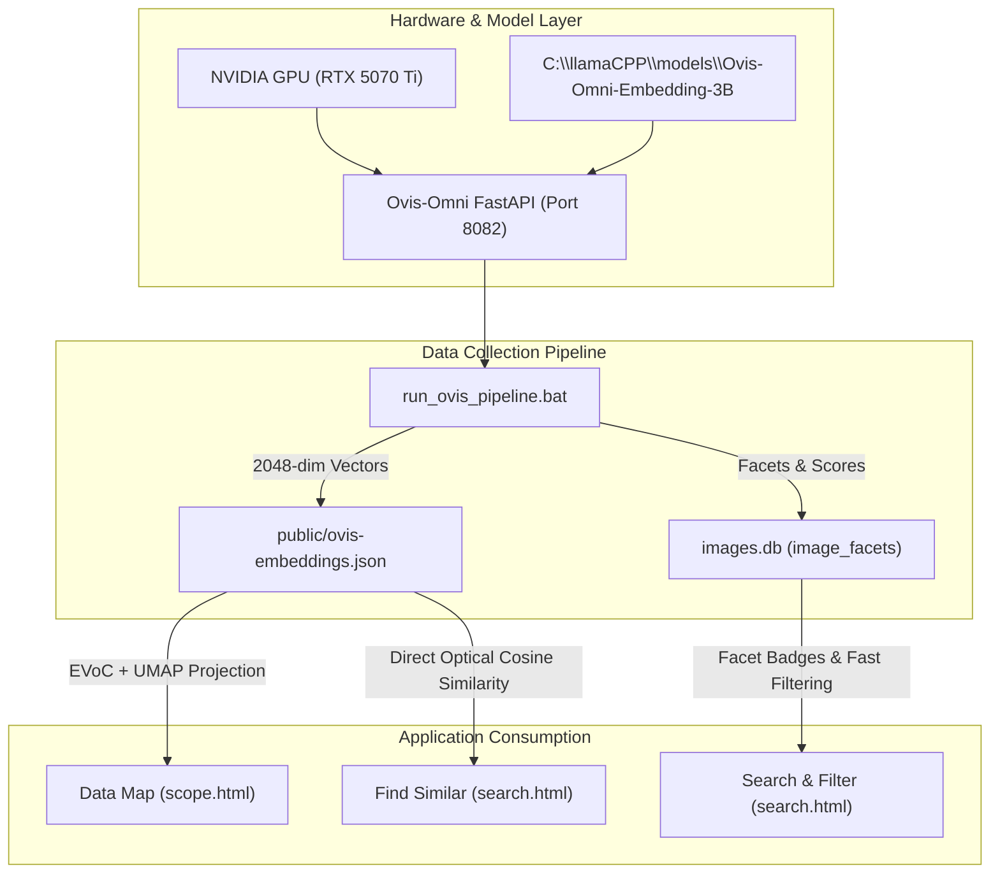

# 🧠 Ovis-Omni Multimodal Engine: Implementation Plan & Operational Guide

> **Lumina (LM AI Studio)** &bull; Dedicated Multimodal Vision & Embedding Pipeline  
> **Model**: `ATH-MaaS/Ovis-Omni-Embedding-3B` &bull; **Engine Port**: `8082` (CUDA `bfloat16`)

---

## 1. Executive Summary & Architecture

Unlike traditional text-only embedding models that require an autoregressive LLM to first caption images into sentences, **Ovis-Omni embeds raw image pixels directly into a unified 2048-dimensional vector space**. 

This unlocks two capabilities in Lumina:
1. **Perceptual Vector Maps & Optical Search**: Images are mapped by visual aesthetics, palette, lighting, and camera composition, bypassing captioning bottlenecks.
2. **Instant Zero-Shot Taxonomic Faceting**: In a single GPU forward pass (~30ms), images are classified into standard taxonomies (Medium, Mood, Framing) and stored directly into SQLite [images.db](file:///c:/Users/Desktop-Dev/Desktop/LM%20AI%20studio/images.db).



---

## 2. Port Architecture Summary

| Port | Service | Role | Launcher |
|:---:|:---|:---|:---|
| **`8080`** | 🎬 **Reserved for VLC** | Free for VLC Media Player HTTP web remote | — |
| **`8081`** | 👁️ **llama-server (Vision)** | Multimodal image captioning (`Qwen 3.5 9B` / `4B`) | [start_llama_server.bat](file:///c:/Users/Desktop-Dev/Desktop/LM%20AI%20studio/start_llama_server.bat) |
| **`8082`** | 🧠 **Ovis-Omni Engine** | Multimodal pixel vectorization & zero-shot classification | [start_ovis_server.bat](file:///c:/Users/Desktop-Dev/Desktop/LM%20AI%20studio/start_ovis_server.bat) |
| **`8083`** | 🔤 **llama-server (Embeddings)** | Nomic text embeddings for semantic search | [start_llama_embeddings.bat](file:///c:/Users/Desktop-Dev/Desktop/LM%20AI%20studio/start_llama_embeddings.bat) |
| **`8765`** | ⚡ **Laya Decision Engine** | Fast ModernBERT query intent & clustering | [start_laya_server.bat](file:///c:/Users/Desktop-Dev/Desktop/LM%20AI%20studio/start_laya_server.bat) |

---

## 3. Step 1: Collecting the Embedded Data

### 3.1 Start the Ovis-Omni Server
Ensure the microservice is running in its dedicated command window:
```powershell
start_ovis_server.bat
```
*(Or via `npm run ovis:serve`)*

**Expected startup log**:
```text
[OVIS-SERVICE] Preparing to load C:\llamaCPP\models\Ovis-Omni-Embedding-3B on cuda...
[OVIS-SERVICE] Loading multimodal processor with native chat template...
[OVIS-SERVICE] Loading model weights into hardware memory...
[OVIS-SERVICE] Successfully initialized Ovis-Omni-Embedding-3B on cuda!
INFO:     Application startup complete.
INFO:     Uvicorn running on http://127.0.0.1:8082
```

---

### 3.2 Run the Data Collection Pipeline
In a separate terminal, launch the pipeline runner:

#### Option A: Full Ingestion (Recommended)
Generates both raw visual vectors and database facet tags:
```powershell
npm run ovis:pipeline
```
*(Or double-click [run_ovis_pipeline.bat](file:///c:/Users/Desktop-Dev/Desktop/LM%20AI%20studio/run_ovis_pipeline.bat))*

#### Option B: Vector-Only Ingestion
Builds only `public/ovis-embeddings.json` (for Map and Visual Similarity):
```powershell
npm run ovis:embed
```

#### Option C: Facet-Only Ingestion
Evaluates unclassified images and writes Medium, Mood, and Composition into SQLite `image_facets`:
```powershell
npm run ovis:classify
```

### 3.3 Built-in Safeguards & Progress Tracking
- **Live Progress Counter**: Displays real-time `[Current / Total]` counters with completion percentage, throughput speed (`img/s`), and an estimated time of arrival (ETA) for every item:
  ```text
  [1/11452] (0.01%) | Speed: 22.4 img/s | ETA: 8m 31s | Vectorized: image_001.png
  [2/11452] (0.02%) | Speed: 23.1 img/s | ETA: 8m 15s | Vectorized: image_002.png
  ...
  [11452/11452] (100.0%) | Speed: 24.2 img/s | ETA: 0m 0s | Vectorized: image_11452.png
  ```
- **Automatic Resume**: The script checks which images are already recorded. If stopped (`CTRL+C`) or rebooted, re-running the script resumes immediately without re-calculating existing images.
- **Atomic Checkpoints**: Vectors are committed to disk every 25 images to prevent data loss.
- **Hardware Throughput**: On an RTX 5070 Ti in `bfloat16`, image processing executes in **~35ms to 50ms per item** (~20-25 images per second).

---

## 4. Step 2: Displaying the Dataset in the Map View (`scope.html`)

The Map page ([public/scope.html](file:///c:/Users/Desktop-Dev/Desktop/LM%20AI%20studio/public/scope.html)) renders high-dimensional vector embeddings as an interactive 2D starfield using **EVoC (Energy-based Visual Clustering)** and **UMAP (Uniform Manifold Approximation and Projection)**.

### 4.1 What Visual Vectors Change on the Map
- **Text Embeddings (`search-embeddings.json`)**: Cluster images by descriptive keywords and text topics.
- **Ovis Visual Embeddings (`ovis-embeddings.json`)**: Cluster images by **visual appearance, artistic style, dominant color palettes, and geometric composition**. Photos cluster with photos, anime with anime, and dark moody landscapes form distinct visual galaxies.

### 4.2 Projecting Ovis Vectors into the Map
Run the EVoC projection script targeting your newly generated `ovis-embeddings.json`:

```powershell
python scripts/evoc_pipeline.py --embeddings public/ovis-embeddings.json --db images.db
```

**What this does**:
1. Loads the 2048-dimensional vectors from `public/ovis-embeddings.json`.
2. Computes hierarchical density clusters via `evoc.EVoC()`.
3. Runs 2D manifold reduction via `umap.UMAP(n_components=2)`.
4. Saves coordinates into `image_coordinates` and cluster assignments into `image_clusters` in [images.db](file:///c:/Users/Desktop-Dev/Desktop/LM%20AI%20studio/images.db).

### 4.3 Viewing in the UI
1. Navigate to the **Map** tab (`http://localhost:3000/scope.html`).
2. Click **"Evoc DB"** at the top right toggle.
3. The Canvas instantly plots all images. You can:
   - **Pan & Zoom**: Scroll wheel and click-drag.
   - **Hover**: Previews thumbnail and visual metadata.
   - **Visual Neighborhoods**: Identify visual outliers, stylistic groupings, and aesthetic clusters.

---

## 5. Step 3: Using the Data in Search (`search.html`)

Once `public/ovis-embeddings.json` and `image_facets` are populated, they integrate into Lumina's search experience across three distinct features:

### 5.1 Direct Optical "Find Similar" (Image-to-Image)
Instead of matching text tags, Lumina compares the 2048-dim vector of a selected image against all other vectors in `ovis-embeddings.json`:
- **API Endpoint**: `POST /api/ovis/find-similar`
- **Payload**:
  ```json
  {
    "image_id": 42,
    "limit": 20
  }
  ```
- **Result**: Instant list of images that share the exact optical composition, lighting, and aesthetic flavor, ranked by dot-product cosine similarity.

### 5.2 Zero-Shot Faceted Search & Filtering
The `image_facets` table stores standardized classifications:
- **Medium**: `real-world photography`, `3D CGI digital render`, `digital concept illustration`, `traditional oil or watercolor painting`, etc.
- **Mood**: `dark, moody and atmospheric`, `bright, vibrant and luminous`, `minimalist, calm and serene`, `dramatic, epic and cinematic`, etc.
- **Composition**: `tight macro close-up focus`, `portrait headshot character framing`, `wide scenic panoramic landscape vista`, etc.

In [public/search.html](file:///c:/Users/Desktop-Dev/Desktop/LM%20AI%20studio/public/search.html):
- Filtering by a facet (e.g. Medium: *Photography* + Mood: *Cinematic*) queries indexed SQLite columns with **sub-millisecond execution**, narrowing down candidates before ranking.

### 5.3 Cross-Modal Text-to-Visual Search
You can search the visual dataset using free-form text:
1. When you type `"neon soaked wet street"`, the text is sent to `POST /embed/text` on port 8082 with the instruction prefix `"Represent this query for retrieving relevant images: "`.
2. Ovis-Omni generates a 2048-dim query vector.
3. [search-worker.js](file:///c:/Users/Desktop-Dev/Desktop/LM%20AI%20studio/public/search-worker.js) computes cosine similarity against `public/ovis-embeddings.json` in the background thread.
4. Images matching that visual description appear at the top, even if the image has zero tags or no AI captions generated yet!

---

## 6. Verification & Health Cheatsheet

### Check Service Health via CLI
```powershell
curl.exe -s http://127.0.0.1:8082/health
```
**Sample Output**:
```json
{
  "status": "online",
  "model_identifier": "C:\\llamaCPP\\models\\Ovis-Omni-Embedding-3B",
  "device": "cuda",
  "cuda_available": true,
  "gpu_device_name": "NVIDIA GeForce RTX 5070 Ti",
  "allocated_vram_mb": 9093.12,
  "embedding_dimensions": 2048
}
```

### Run Diagnostic Script
```powershell
node scripts/test_ovis_integration.js
```

### Interactive Swagger UI
Open your browser to:
[http://127.0.0.1:8082/docs](http://127.0.0.1:8082/docs)  
Test text vectors, image embeddings, and classification directly with FastAPI's interactive console.
