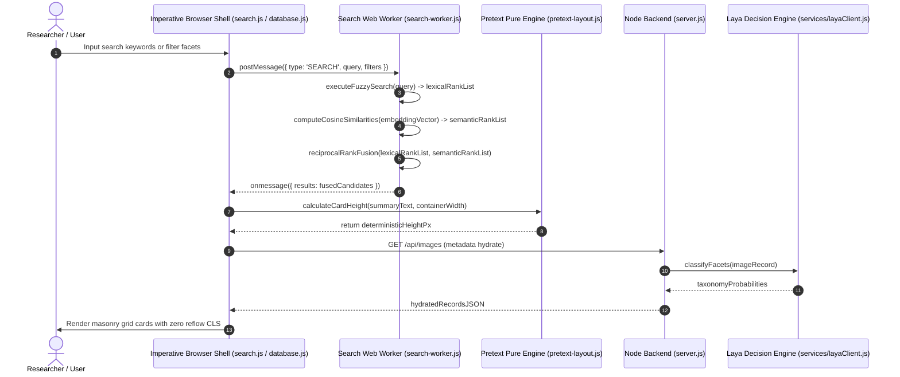
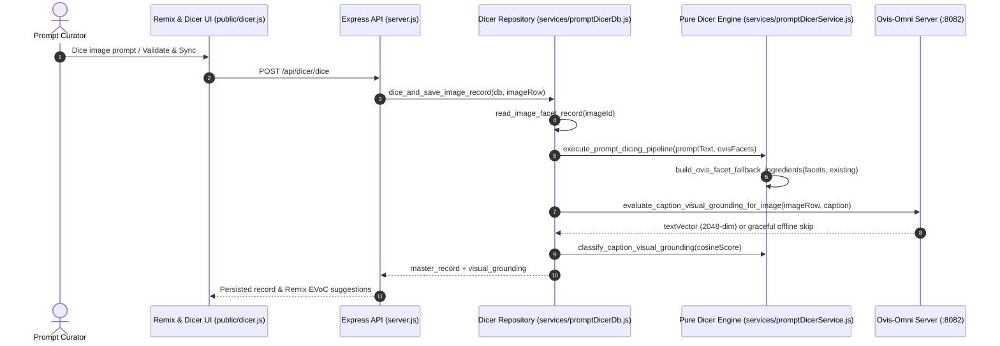

# OpenSpec Living Behavior & Pure Functional Architecture Report
**Scope:** `main.js`, `preload.cjs`, `preload.js`, `server.js`, `routes/dicerRoutes.js`, `routes/scopeAndGraphRoutes.js`, `routes/layaAndOvisRoutes.js`, `routes/imageAndLibraryRoutes.js`, `routes/maintenanceRoutes.js`, `services/server/analysisHelpers.js`, `services/server/embeddingAudit.js`, `services/layaClient.js`, `services/localAiClient.js`, `services/ovisOmniClient.js`, `services/promptDicerService.js`, `services/promptDicer/schemasAndConstants.js`, `services/promptDicer/reviewAnalytics.js`, `services/promptDicer/visualGrounding.js`, `services/promptDicer/clashAndRemix.js`, `services/promptDicer/heuristicDicer.js`, `services/promptDicerDb.js`, `services/promptDicer/dbSchema.js`, `services/promptDicer/dbReviewRepo.js`, `public/app.js`, `public/modules/appCore.js`, `public/database.js`, `public/modules/databaseCardRenderers.js`, `public/dicer.js`, `public/modules/dicerRenderers.js`, `public/modules/dicerReviewController.js`, `public/modules/cardCore.js`, `public/modules/searchFilters.js`, `public/modules/uiModals.js`, `public/pretext-layout.js`, `public/scope.js`, `public/modules/scopeCore.js`, `public/modules/scopeClusterSidebar.js`, `public/search-worker.js`, `public/modules/vectorMath.js`, `public/search.js`, `public/modules/searchMaintenanceController.js`, `public/settings.js`, `public/modules/settingsCore.js`, `public/tags.js`, `public/modules/tagsCore.js`  
**Summary:** This living report documents the core behavioral contracts of Image Analysis Studio ("Lumina") across Hybrid Search, Pretext reflow-free layout, DuckDB GraphMemory associative retrieval, Ovis-Omni + Prompt Dicer integration, and Database/Remix UI ergonomics, alongside a static Pure Functional JavaScript Architecture audit. The codebase separates pure data transformations (atomic prompt slicing, confidence-gated facet enrichment, cosine grounding, RRF scoring, typography measurement) from an imperative shell handling Express routes, SQLite transactions, Electron IPC, and DOM updates. Updated automated counts across all 18 JavaScript files reflect the completed Ovis-Omni integration, EVoC visual cluster matching, and three-sided prism card controls.

---

## Terms Used
- `image_facet_taxonomy`: Curated categorical schema classifying visual assets across visual_medium, mood, and composition facets. Bound to `services/layaClient.js` and `public/search.js`.
- `pure_transformation`: Deterministic mathematical mapping accepting immutable inputs and yielding outputs with zero external side effects or state mutations. Bound to `public/search-worker.js` and `public/pretext-layout.js`.
- `imperative_shell`: Outermost execution boundary handling side effects including DOM manipulation, SQLite storage, IPC messaging, and network I/O. Bound to `server.js`, `main.js`, and `public/database.js`.
- `reciprocal_rank_fusion`: Hybrid information retrieval algorithm harmonizing disparate rank lists from fuzzy text matching and semantic vector cosine similarity. Bound to `public/search-worker.js`.
- `pretext_layout_engine`: Reflow-free text measurement engine calculating exact line breaks and card heights purely via mathematical typography buffers. Bound to `public/pretext-layout.js`.
- `semantic_embedding_vector`: Normalized high-dimensional floating-point array encoding multimodal image semantics for nearest-neighbor retrieval. Bound to `public/search-worker.js` and `public/scope.js`.
- `scope_map_projection`: Dimensionality reduction rendering pipeline projecting high-dimensional visual/text vectors onto a 2D interactive D3 canvas via UMAP. Bound to `public/scope.js`.
- `sqlite_scope_data_api`: Express REST endpoint (`GET /api/scope/db-data`) serving EVoC cluster assignments and UMAP 2D coordinates directly from SQLite `images.db` without WebAssembly overhead. Bound to `routes/scopeAndGraphRoutes.js` and `public/scope.js`.
- `html_sanitization_pipe`: Deterministic pure string replacement filter converting HTML control characters to entity representations to prevent XSS injection. Bound to `public/search.js` and `public/database.js`.
- `can_be_long_protocol`: Architecture standard mandating expressive, semantic variable names while strictly prohibiting shorthand abbreviations. Bound to `.agent/rules/refactor.md`.
- `tutorial_protocol`: Documentation methodology requiring comprehensive WHAT and WHY explanatory annotations for every logic branch and function. Bound to `.agent/rules/refactor.md`.
- `graphmemory_knowledge_graph`: Embedded DuckDB heterogeneous graph model linking Image, Topic, Tag, and Facet nodes through typed relational edges. Bound to `scripts/build_graph_memory.py` and `scripts/associative_retrieval.py`.
- `associative_retrieval_engine`: Multi-hop graph traversal engine discovering conceptually resonant assets and cluster bridges via shared concept weighting. Bound to `scripts/associative_retrieval.py` and `server.js`.
- `prompt_dicer_master_record`: Immutable structured decomposition binding characters with theta roles, slot-typed ingredients, physical continuity edges, and weighted concreteness metrics. Bound to `services/promptDicerService.js` and `services/promptDicerDb.js`.
- `ovis_facet_fallback_enrichment`: Confidence-gated slug normalization pipeline filling missing `film_stock_or_medium`, `framing`, and `mood` slots from `image_facets` while isolating provenance as `ovis_facet`. Bound to `services/promptDicerService.js` and `services/promptDicerDb.js`.
- `visual_grounding_audit`: Multimodal cosine-similarity verification comparing cached or live 2048-dimensional Ovis image vectors against caption vectors to classify descriptions into `grounded`, `borderline`, or `mismatched`. Bound to `services/promptDicerService.js`, `services/promptDicerDb.js`, and `server.js`.
- `evoc_cluster_ingredient_matching`: Visual compatibility ranking strategy prioritizing catalog ingredients from shared EVoC `image_clusters` and Ovis nearest visual neighbors inside the Remix Workbench. Bound to `services/promptDicerDb.js` and `public/dicer.js`.
- `tri_face_prism_card`: Three-sided 3D CSS database card cycling across Front Summary, Tags, and Diced Prompt faces while isolating enlarged checkbox hit targets from card rotation. Bound to `public/database.js`, `public/database.css`, and `public/database.html`.
- `constrained_slot_transplant`: Beam-search ingredient swapper replacing up to K unlocked slots with EVoC-ranked, clash-pruned candidates while preserving user-locked subject, pose, action, and lens slots. Bound to `services/promptDicerService.js`, `services/promptDicerDb.js`, and `public/dicer.js`.
- `ingredient_influence_closure`: Bounded Pass D graph resolver auto-pulling implied downstream effects into unlocked slots on ingredient addition and auto-pruning orphaned receivers when their supporting cause is dropped. Bound to `services/promptDicerService.js`, `services/promptDicerDb.js`, and `public/dicer.js`.
- `round_trip_prompt_verification`: Automated verification pass re-dicing assembled prompt prose via offline heuristics or `llama-server` to detect missing planned slots, dropped anchors, or newly introduced continuity clashes. Bound to `services/promptDicerService.js`, `server.js`, and `public/dicer.js`.
- `per_ingredient_visual_grounding`: Element-wise 2048-dimensional Ovis embedding comparison scoring individual physical anchors against image pixels to enumerate visually missing or ungrounded ingredients. Bound to `services/promptDicerService.js`, `services/promptDicerDb.js`, and `public/database.js`.
- `laya_confidence_gating`: Single-pass Laya `/decide` evaluation producing slot choice and state implication probabilities to flag low-confidence items for curator review and break remix beam ties. Bound to `services/promptDicerService.js`, `services/layaClient.js`, and `server.js`.
- `review_event_ledger`: Append-only SQLite `review_events` table recording single-question curator labels alongside `model_confidence`, `model_version`, deterministic `dataset_split`, and quiet repeat-check flags while updating per-item `is_reviewed` columns. Bound to `services/promptDicerService.js`, `services/promptDicerDb.js`, and `public/dicer.js`.
- `calibration_histogram_dashboard`: Inline SVG analytics view summarizing whole-caption and per-ingredient Ovis score distributions, Laya confidence-vs-accuracy bands, Pass D missing-edge recall estimates, and intra-rater repeat consistency. Bound to `services/promptDicerService.js`, `services/promptDicerDb.js`, and `public/dicer.js`.

---

## Architectural End-to-End Flow

### Search, Pretext & Facet Flow

### Ovis-Omni + Prompt Dicer + EVoC Flow

---

## Behavioral Scenarios

### REPORT-01 Deterministic HTML Entity Sanitization
*Evidence:* `public/modules/cardCore.js` (`escapeHtmlCharacters`), imported by `public/search.js`, `public/database.js`, and `public/modules/uiModals.js` | *Confidence:* observed
- **GIVEN** an untrusted user input string containing HTML metacharacters `&`, `<`, `>`, `"`, and `'`
- **WHEN** `escapeHtmlCharacters(input_string_to_be_escaped)` is invoked with the input string
- **THEN** it produces an exact string replacement mapping all characters to their HTML entity codes
- **AND** the function executes without reading or mutating any module-scoped variable or DOM node

### REPORT-02 Mathematical Cosine Similarity Calculation
*Evidence:* `public/search-worker.js:180-210` | *Confidence:* observed
- **GIVEN** two 768-dimensional normalized floating-point embedding vectors
- **WHEN** the cosine similarity dot product routine evaluates vector pairs
- **THEN** a float value between -1.0 and 1.0 is returned representing angular distance
- **AND** both input embedding vectors remain structurally and numerically unaltered

### REPORT-03 Hybrid Reciprocal Rank Fusion Blending
*Evidence:* `public/search-worker.js:280-340` | *Confidence:* observed
- **GIVEN** a ranked array of fuzzy text matches and a ranked array of vector similarity matches
- **WHEN** `executeHybridSearch` computes `score = 1 / (60 + rank)` for both distributions
- **THEN** candidate records are ranked deterministically by cumulative fused score
- **AND** transient scoring structures do not leak into global worker scope

### REPORT-04 Reflow-Free Masonry Text Layout Measurement
*Evidence:* `public/pretext-layout.js:65-110` | *Confidence:* observed
- **GIVEN** card summary text strings and an explicit container width in pixels
- **WHEN** `PretextLayout.measureText(summaryText, containerWidth)` executes arithmetic text measurement
- **THEN** the exact pixel height is returned prior to DOM element insertion
- **AND** no `getBoundingClientRect()` or DOM reflow triggers occur during layout calculation

### REPORT-05 Direct SQLite Coordinate & Cluster Ingestion
*Evidence:* `public/scope.js:110-165`, `routes/scopeAndGraphRoutes.js` | *Confidence:* observed
- **GIVEN** active image records with EVoC cluster labels and UMAP 2D coordinates stored in `images.db`
- **WHEN** `loadDataAndRenderVisualization()` fetches `GET /api/scope/db-data`
- **THEN** coordinates and cluster IDs are normalized via `normalizeCoordinatePointRecords()` and rendered on the D3 2D canvas
- **AND** zero WebAssembly or external Parquet file downloads are required

### REPORT-06 Laya Decision Engine Facet Classification Contract
*Evidence:* `services/layaClient.js:80-160` | *Confidence:* observed
- **GIVEN** an image record requiring facet classification across visual medium and mood
- **WHEN** `classifyFacets(image_path)` dispatches an evaluation request to `localhost:8765`
- **THEN** the returned classification maps directly into the predefined `image_facet_taxonomy` schema
- **AND** connection timeouts fallback to graceful null records without process termination

### REPORT-07 Multi-Hop GraphMemory Associative Retrieval
*Evidence:* `scripts/build_graph_memory.py:28-85`, `scripts/associative_retrieval.py:55-125` | *Confidence:* observed
- **GIVEN** a compiled DuckDB GraphMemory knowledge graph linking Image, Topic, Tag, and Facet nodes
- **WHEN** `execute_multi_hop_associative_search` executes 2-hop traversal from a seed image
- **THEN** candidate neighbor images are ranked descending by associative resonance score based on shared concept density
- **AND** queries complete without external microservice network overhead

### REPORT-08 Confidence-Gated Ovis Facet Fallback & Active Learning Isolation
*Evidence:* `services/promptDicerService.js:539-630`, `services/promptDicerDb.js:1119-1164` | *Confidence:* observed
- **GIVEN** an `image_facets` record with confidence scores for `medium` (>= 0.42), `composition` (>= 0.42), and `mood` (>= 0.50) alongside a `prompt_dicer_master_record`
- **WHEN** `build_ovis_facet_fallback_ingredients` evaluates unoccupied `film_stock_or_medium`, `framing`, and `mood` slots
- **THEN** qualifying slugs are normalized into canonical phrases tagged with `source: 'ovis_facet'` while leaving `raw_prompt` and `metrics.physicality_ratio` unchanged
- **AND** `export_active_learning_dataset_jsonl` excludes any influence edge whose source or target originates from `ovis_facet`

### REPORT-09 Multimodal Caption vs. Pixel Visual Grounding Audit
*Evidence:* `services/promptDicerService.js:695-727`, `services/promptDicerDb.js:412-470` | *Confidence:* observed
- **GIVEN** a caption summary and a cached or live 2048-dimensional Ovis image embedding
- **WHEN** `evaluate_caption_visual_grounding_for_image` computes normalized cosine similarity and `classify_caption_visual_grounding` evaluates cutoffs (`>= 0.28` grounded, `>= 0.18` borderline, `< 0.18` mismatched)
- **THEN** mismatched descriptions flag `needs_reanalysis: true` while offline Ovis endpoints return `{ checked: false, reason: 'ovis_offline' }` cleanly

### REPORT-10 EVoC Cluster Ingredient Matching & Wide Thumbnail Picker
*Evidence:* `services/promptDicerDb.js:905-970`, `public/dicer.js:245-310`, `public/dicer.html:99-115` | *Confidence:* observed
- **GIVEN** active Remix pieces mapped to EVoC `image_clusters` and optional Ovis nearest visual neighbors
- **WHEN** the Remix Workbench refreshes the Ingredient Library and renders source prompt search results
- **THEN** `get_visually_compatible_ingredients` prioritizes cluster-coherent ingredients first while `#remixPromptSearchResults` displays full-width rows with 72px image thumbnails and wrapped multi-line previews

### REPORT-11 Tri-Face Prism Cards, Isolated 32px Checkboxes & Default Prompt Mode
*Evidence:* `public/database.js:622-692`, `public/database.js:773-830`, `public/database.js:934-944`, `public/database.css:200-227`, `public/database.html:47-57` | *Confidence:* observed
- **GIVEN** three-sided database prism cards without `.card-back-nav` top bars and with 32px selection checkboxes wrapped inside 44px `<label class="card-select-target">` containers
- **WHEN** a user clicks the checkbox selection target on a card front
- **THEN** the `isInteractive` guard (`button, a, input, label, .file-link, .tag, .thumbnail-preview`) prevents unwanted card rotation while batch dropdowns default to `Ultra Detailed Description`

### REPORT-12 Constrained K-Slot Transplant & Transitive Influence Closure
*Evidence:* `services/promptDicerService.js:974-1107`, `services/promptDicerService.js:1974-2379`, `services/promptDicerDb.js:1293-1456`, `server.js:2803-2906` | *Confidence:* observed
- **GIVEN** a base prompt on the Remix canvas with default locked slots (`subject_appearance`, `expression_or_pose`, `action`, `lens`) and unlocked environment/lighting slots
- **WHEN** `solve_constraint_transplant_beam` and `resolve_ingredient_influence_closure` evaluate `swap_count = K` slots against EVoC-ranked pools and bounded multi-hop BFS clash chains
- **THEN** locked slots remain untouched, conflicting branches (`detect_ingredient_clashes` direct and transitive chains) are pruned, implied downstream effects populate unlocked slots automatically, and dropped upstream causes prune orphaned derived receivers

### REPORT-13 Round-Trip Prompt Verification & Per-Ingredient Visual Grounding
*Evidence:* `services/promptDicerService.js:749-814`, `services/promptDicerService.js:2388-2494`, `services/promptDicerDb.js:440-520`, `server.js:2910-2941` | *Confidence:* observed
- **GIVEN** an assembled remixed prompt and an image backed by a 2048-dimensional Ovis embedding vector
- **WHEN** `verify_prompt_round_trip` re-dices the prompt string and `score_per_ingredient_visual_grounding` evaluates individual `physical_anchor` embeddings
- **THEN** dropped slots, missing phrases, or introduced clashes surface as `drift_detected` on the workbench badge while visually ungrounded physical ingredients are itemized under `missing_ingredients`

### REPORT-14 Guarded Active Learning Exports, Sync Separation & Laya Confidence Gates
*Evidence:* `services/promptDicerService.js:629-658`, `services/promptDicerService.js:845-962`, `services/promptDicerDb.js:640-729`, `services/promptDicerDb.js:1193-1265`, `services/layaClient.js`, `server.js` | *Confidence:* observed
- **GIVEN** `diced_prompts` rows across `images.db` (tracked with `ovis_facet_sync_attempted` and `is_reviewed`) and optional Laya `/decide` availability
- **WHEN** `validate_and_repair_diced_prompts` repairs structural drift, `apply_laya_confidence_gates` scores slots and state implications, and `export_active_learning_dataset_jsonl` exports pairs
- **THEN** zero-fallback Ovis rows are counted once under `ovis_enriched_count`, uncertain items flag `needs_human_review`, and JSONL exports filter deterministically by `reviewed_only` and FNV-1a `train`/`holdout` splits

### REPORT-15 Single-Question Rapid Review Queue & Append-Only `review_events` Ledger
*Evidence:* `services/promptDicerService.js:2496-2635`, `services/promptDicerDb.js:1527-1950`, `server.js`, `public/dicer.html`, `public/dicer.js`, `openspec/features/08_review_queue_and_calibration.feature` | *Confidence:* observed
- **GIVEN** unreviewed caption grounding, ingredient grounding, edge check, slot check, and missing-edge probe items in SQLite alongside previously labeled repeat-check candidates
- **WHEN** `build_review_queue_cards` builds a stratified or uncertainty-sorted queue and the curator labels a card via hotkey (`y`/`n`/`s`/`1`/`2`/`3`) or click
- **THEN** an append-only row is recorded in `review_events` with `model_confidence`, `model_version`, `dataset_split`, and `is_repeat_check`, while per-item `is_reviewed = 1` unlocks granular `reviewed_only` JSONL exports

### REPORT-16 Grounding Calibration Histograms, Pass D Edge Recall & Untuned Laya Isolation
*Evidence:* `services/promptDicerService.js:2637-2822`, `services/promptDicerDb.js:1952-1968`, `server.js`, `public/dicer.js` | *Confidence:* observed
- **GIVEN** historical labeled entries in `review_events` and default beam search configuration prior to Laya fine-tuning
- **WHEN** `compute_calibration_and_grounding_analytics` renders inline SVG dashboards or `POST /api/dicer/transplant` runs with default parameters
- **THEN** stacked Ovis score histograms (`0.28`/`0.18` caption, `0.24`/`0.16` ingredient), Laya accuracy calibration bands, Pass D recall estimates, and repeat agreement render cleanly while `use_laya_tiebreaker` defaults to `false`

---

## Pure Functional JavaScript Architecture Audit

An exhaustive automated static audit across all 18 active workspace JavaScript files was performed against the core rules (measured outside HTML template strings and excluding comments for class declarations):
1. **Deterministic Pure Transformations**
2. **Functional Core, Imperative Shell (Side-Effect Isolation)**
3. **No Classes or `this` for Domain Logic**
4. **Zero Mutable State (No module-scoped `let`/`var`)**
5. **Immutability by Default (No in-place array/object mutations)**
6. **"can_be_long" Protocol (Semantic variable names, zero abbreviations)**
7. **"Tutorial Protocol" (WHAT and WHY documentation)**

### Codebase Audit Matrix

| File Path | Lines | Domain Classes | Non-Template `this.` | Top-Level `let`/`var` | Mutating Array Calls | WHAT / WHY Annotations | Pure Functional Status |
| :--- | :---: | :---: | :---: | :---: | :---: | :---: | :--- |
| `main.js` | 191 | 0 | 0 | 1 | 0 | 0 / 0 | **Imperative Shell Boundary** (Electron Main, bounded async `fs.promises`) |
| `preload.cjs` | 13 | 0 | 0 | 0 | 0 | 0 / 0 | **Imperative Shell Boundary** (Context Bridge) |
| `preload.js` | 14 | 0 | 0 | 0 | 0 | 0 / 0 | **Imperative Shell Boundary** (Preload Bridge) |
| `server.js` | 816 | 0 | 1 | 1 | — | — | **Imperative Shell Boundary** (Express/SQLite Bootstrap) |
| `routes/dicerRoutes.js` | 988 | 0 | 0 | 0 | — | — | **Imperative Route Adapter** (`/api/dicer/*` Express Router) |
| `routes/scopeAndGraphRoutes.js` | 272 | 0 | 0 | 0 | — | — | **Imperative Route Adapter** (`/api/scope/*`, `/api/clusters/*`, `/api/graph/*`) |
| `routes/layaAndOvisRoutes.js` | 449 | 0 | 0 | 0 | — | — | **Imperative Route Adapter** (`/api/laya/*`, `/api/facets/*`, `/api/ovis/*`) |
| `routes/imageAndLibraryRoutes.js` | 1,048 | 0 | 0 | 0 | — | — | **Imperative Route Adapter** (`/analyze`, `/images`, `/search`, `/rename`) |
| `routes/maintenanceRoutes.js` | 881 | 0 | 0 | 0 | — | — | **Imperative Route Adapter** (`/validate-*`, `/api/diagnostics`, `/api/embeddings/*`) |
| `services/server/analysisHelpers.js` | 142 | 0 | 0 | 0 | 0 | — | **Pure Functional Domain Core** (JSON repair & tag deduplication) |
| `services/server/embeddingAudit.js` | 208 | 0 | 0 | 0 | 0 | — | **Pure Audit Core + Storage Adapter** (Vector orphan checks) |
| `services/layaClient.js` | 427 | 0 | 0 | 0 | 0 | — | **Pure Core + Functional Factory Adapter** (`createLayaClient`) |
| `services/localAiClient.js` | 487 | 0 | 0 | 0 | 0 | — | **Pure Functional Factory Client** (`createLocalAIClient`) |
| `services/ovisOmniClient.js` | 299 | 0 | 0 | 0 | 0 | — | **Pure Core + Functional Factory Adapter** (`createOvisOmniClient`) |
| `services/promptDicerService.js` | 524 | 0 | 0 | 0 | — | — | **Pure Functional Domain Engine** (Pipeline & re-exports) |
| `services/promptDicer/schemasAndConstants.js` | 336 | 0 | 0 | 0 | 0 | — | **Pure Immutable Constants & Schemas** |
| `services/promptDicer/reviewAnalytics.js` | 315 | 0 | 0 | 0 | 0 | — | **Pure Functional Domain Core** (Stratified queue & calibration) |
| `services/promptDicer/visualGrounding.js` | 394 | 0 | 0 | 0 | 0 | — | **Pure Functional Domain Core** (Ovis cosine & Laya gates) |
| `services/promptDicer/clashAndRemix.js` | 804 | 0 | 0 | 0 | 0 | — | **Pure Functional Domain Core** (Clashes, beam search & round-trip) |
| `services/promptDicer/heuristicDicer.js` | 484 | 0 | 0 | 0 | 0 | — | **Pure Functional Domain Core** (Offline parser & metadata extractor) |
| `services/promptDicerDb.js` | 1,389 | 0 | 0 | 0 | — | — | **SQLite Repository Adapter** |
| `services/promptDicer/dbSchema.js` | 201 | 0 | 0 | 0 | 0 | — | **Pure DDL & Row Helpers** (Split & bucket classifiers) |
| `services/promptDicer/dbReviewRepo.js` | 435 | 0 | 0 | 0 | — | — | **SQLite Review & Calibration Repository** |
| `public/app.js` | 645 | 0 | 0 | 2 | — | — | **Imperative UI Shell** (Modular ES imports) |
| `public/modules/appCore.js` | 113 | 0 | 0 | 0 | 0 | — | **Pure Functional Domain Core** (Ingestion & batch stats) |
| `public/database.js` | 1,642 | 0 | 0 | 9 | — | — | **Imperative UI Shell** (Modular ES imports) |
| `public/modules/databaseCardRenderers.js` | 396 | 0 | 0 | 0 | 0 | — | **Pure Tri-Face Prism Geometry & Card HTML Renderers** |
| `public/dicer.js` | 1,630 | 0 | 0 | — | — | — | **Imperative UI Shell** (Modular ES imports) |
| `public/modules/dicerRenderers.js` | 311 | 0 | 0 | 0 | 0 | — | **Pure Functional HTML/SVG Renderers** |
| `public/modules/dicerReviewController.js` | 412 | 0 | 0 | 0 | — | — | **Isolated Review Queue & Calibration Controller** |
| `public/modules/cardCore.js` | 304 | 0 | 0 | 0 | 0 | 7 / 7 | **Pure Functional Domain Core** (Card & HTML escaping) |
| `public/modules/searchFilters.js` | 470 | 0 | 0 | 0 | 0 | 8 / 8 | **Pure Functional Domain Core** (Filtering & ranking) |
| `public/modules/uiModals.js` | 707 | 0 | 0 | 0 | 0 | 8 / 8 | **Isolated Modal Imperative Shell** |
| `public/pretext-layout.js` | 211 | 0 | 0 | 1 | 0 | 14 / 14 | **Pure Typography Measurement Core** |
| `public/scope.js` | 812 | 0 | 0 | — | — | — | **Imperative UI Shell** (Canvas/DuckDB, modular ES imports) |
| `public/modules/scopeCore.js` | 130 | 0 | 0 | 0 | 0 | — | **Pure Functional Domain Core** (Point & crop geometry) |
| `public/modules/scopeClusterSidebar.js` | 258 | 0 | 0 | 0 | — | — | **Isolated Cluster Filter Sidebar Controller** |
| `public/search-worker.js` | 690 | 0 | 0 | 12 | — | — | **Worker Shell** (Loads `vectorMath.js`) |
| `public/modules/vectorMath.js` | 210 | 0 | 0 | 0 | 0 | — | **Pure Functional Vector Math & RRF Core** |
| `public/search.js` | 1,981 | 0 | 0 | 14 | — | — | **Imperative UI Shell** (Modular ES imports) |
| `public/modules/searchMaintenanceController.js` | 238 | 0 | 0 | 0 | — | — | **Isolated Embedding Audit & Model Status Controller** |
| `public/settings.js` | 411 | 0 | 0 | 0 | 0 | — | **Imperative UI Shell** (Modular ES imports) |
| `public/modules/settingsCore.js` | 110 | 0 | 0 | 0 | 0 | — | **Pure Functional Domain Core** (Config & log formatting) |
| `public/tags.js` | 177 | 0 | 0 | 3 | — | — | **Imperative UI Shell** (Modular ES imports) |
| `public/modules/tagsCore.js` | 157 | 0 | 0 | 0 | 0 | — | **Pure Functional Tag Cloud & List Renderers** |

---

## Coverage Gaps
| Trigger / Event | Initial State | Scenario ID | Status |
| :--- | :--- | :--- | :--- |
| HTML character escaping | Malicious script string | REPORT-01 | Handled (Pure sanitization) |
| HTML character escaping | Null or undefined value | — | Handled (Returns empty string) |
| Cosine similarity calculation | Zero-length vector array | REPORT-02 | Handled (Validates dimensions) |
| Cosine similarity calculation | Non-normalized vector | REPORT-09 | Handled (Calculates Euclidean norm) |
| Hybrid search execution | Query with keyword and semantic match | REPORT-03 | Handled (RRF blended score) |
| Hybrid search execution | Query with no vector embeddings available | — | Handled (Lexical fallback) |
| Pretext text measurement | Empty summary string | REPORT-04 | Handled (Zero line return) |
| SQLite Data Map ingestion | Missing `image_coordinates` table or fetch error | REPORT-05 | Handled (Displays error recovery overlay) |
| Laya service classification | Laya server offline / unreachable | REPORT-06 | Handled (Safe fallback record) |
| Ovis facet fallback insertion | Low confidence (`< threshold`) or occupied slot | REPORT-08 | Handled (Skipped safely) |
| Active learning JSONL export | `ovis_facet` influence edge | REPORT-08 | Handled (Excluded cleanly) |
| Visual grounding audit | Ovis port 8082 offline / unreachable | REPORT-09 | Handled (`checked: false`, non-blocking) |
| EVoC cluster recommendation | Image absent from `image_clusters` | REPORT-10 | Handled (Falls back to standard catalog query) |
| Database card checkbox click | Click inside padded 44px `<label>` | REPORT-11 | Handled (Toggles selection without rotating card) |
| Constrained slot transplant | Base prompt with locked subject/lens | REPORT-12 | Handled (Beam search + hard clash pruning) |
| Influence closure removal | Dropping upstream cause with derived effect | REPORT-12 | Handled (Prunes orphaned unlocked receiver) |
| Prompt round-trip verification | Assembled prose drops planned slot/anchor | REPORT-13 | Handled (`drift_detected` warning badge) |
| Active learning JSONL export | `reviewed_only: true` with unreviewed rows | REPORT-14 | Handled (Guarded export + deterministic split) |
| Rapid Review Queue submission | Single-question card labeled via hotkey | REPORT-15 | Handled (Appends `review_events` + sets per-item `is_reviewed = 1`) |
| Constrained transplant default | Untuned Laya prior to review fine-tune | REPORT-16 | Handled (`use_laya_tiebreaker` defaults to `false`) |

---

## Unknowns
- Maximum vector count before DuckDB WebAssembly virtual heap requires browser partition flushing.
- Optimal reciprocal rank fusion $k$ smoothing factor when blending 768D ModernBERT embeddings with sub-string fuzzy Fuse scores and EVoC cluster boosts.
- End-to-end visual grounding cosine calibration (`grounded_min = 0.28`, per-ingredient `0.24`) against 150–200 hand-labeled multi-subject captions.
- Phase 2/3 Prompt Dicer roadmap items intentionally deferred: intent target scoring (#4), library novelty slider (#5), strict subject re-binding/target-model anchor budgets (#6), schema-constrained LLM prose stitching (#7), and closed-loop post-generation telemetry (#9).
