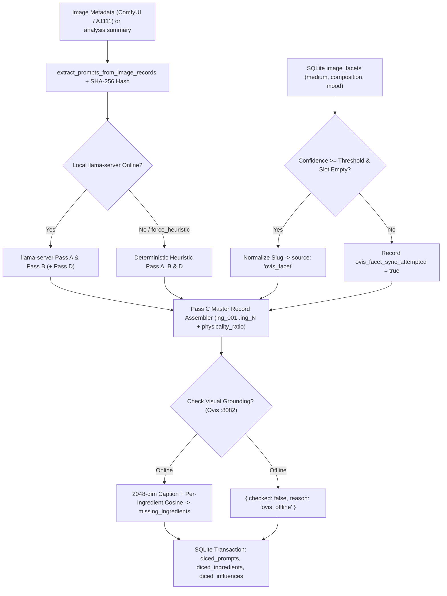
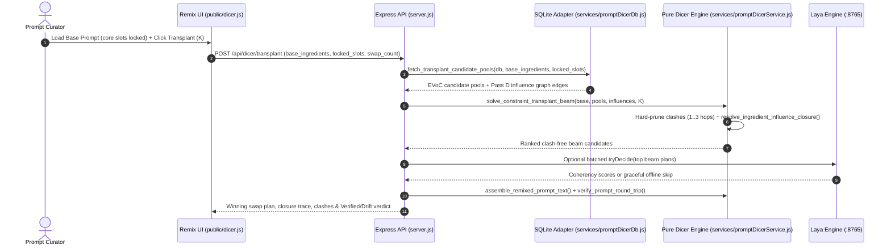

# Prompt Dicer & Constrained Remix Workbench Report
**Scope:** `services/promptDicerService.js`, `services/promptDicerDb.js`, `services/layaClient.js`, `server.js` (`/api/dicer/*`), `public/dicer.html`, `public/dicer.js`, `public/dicer.css`, `public/database.js`, `openspec/features/06_prompt_dicer_pipeline_and_catalog.feature`, `openspec/features/07_ovis_dicer_and_card_ui.feature`, `openspec/reports/ARCHITECTURE_REPORT.md`  
**Summary:** Prompt Dicer decomposes unstructured image/video generation prompts and vision captions into structured, slot-typed atomic ingredients bound to explicit actors and physical continuity edges (`prompt_dicer_master_record`). On top of cataloging and Ovis-Omni multimodal enrichment, its Remix Workbench now performs constrained K-slot beam transplantation across unlocked slots, bidirectional Influence Closure, multi-hop transitive clash detection, Laya confidence gating, and fast heuristic/LLM round-trip verification. This report explains what Prompt Dicer does, how its end-to-end pipeline and remix engine work, and embeds the synchronized Prompt Dicer excerpt from the OpenSpec Living Behavior & Pure Functional Architecture Report.

---

## 1. What Prompt Dicer Does

Prompt Dicer turns raw prompt text and AI image summaries into a searchable, graph-connected catalog so curators can recombine proven parts without breaking visual or physical consistency:

1. **Deconstruct Prompts Into 14 Controlled Slots:** Separates characters (`subject_1`, `subject_2`) with theta roles (`AGENT`, `PATIENT`, `SPECTATOR`) from camera, lighting, weather, setting, palette, audio, and medium clauses across `ALLOWED_INGREDIENT_SLOTS`.
2. **Quantify & Upgrade Abstract "Vibe" Words:** Separates measurable concrete instructions (`physical_anchor`, e.g. `85mm`, `5600K`, `f/2.8`) from abstract buzzwords (`pretext_term`, e.g. `"cinematic"`), computes a weighted `physicality_ratio`, and swaps pretext terms for concrete observable camera/lighting replacements during remixing.
3. **Catch Direct & Multi-Hop Transitive Clashes:** Evaluates `diced_influences` edges via cycle-safe bounded BFS (`max_hops = 3`) in `detect_ingredient_clashes` so direct and downstream chained contradictions (`rain -> wet surfaces -> reflections` vs. dry sun) surface immediately.
4. **Constrained K-Slot Transplantation & Influence Closure (Phase 1):**
   - Locks core subject/lens slots (`subject_appearance`, `expression_or_pose`, `action`, `lens`) by default in `#activeSlotsContainer` while letting users toggle locks per slot.
   - Replaces up to `K` unlocked slots via beam search pruned strictly against clashes, ranked by EVoC cluster compatibility, physicality, and graph synergy, with an optional single batched Laya `/decide` tie-breaker (`POST /api/dicer/transplant`) and one-click **Undo**.
   - Runs **Influence Closure** (`resolve_ingredient_influence_closure`) to pull implied downstream effects into unlocked slots on add and prune orphaned derived receivers when an upstream cause is removed.
5. **Verify Outputs & Ground Captions Visually:**
   - Runs **Round-Trip Verification** (`verify_prompt_round_trip`) in offline heuristic mode inside `/api/dicer/remix-preview` (plus optional full `llama-server` re-dicing on `POST /api/dicer/round-trip-check`) to flag dropped slots, missing anchors, or newly introduced clashes.
   - Runs **Whole-Caption & Per-Ingredient Visual Grounding** via cached/live 2048-dim Ovis embeddings (`score_per_ingredient_visual_grounding`), listing `missing_ingredients` on mismatched items and Database cards (`Side 3`).
6. **Clean Sync & Guarded Dataset Exports:** Tracks `ovis_facet_sync_attempted` cleanly in `validate_and_repair_diced_prompts` (separating `ovis_enriched_count` from structural `desynced_repaired_count`) and guards JSONL exports with `reviewed_only` and deterministic FNV-1a `train`/`holdout` splits.

### Observed Live Library Snapshot (`images.db`)
- **Diced prompts synced:** `11,452` rows (`diced_prompts` + `13,692` `diced_influences` edges; `0` marked `is_reviewed = 1` at baseline snapshot)
- **Cataloged `diced_ingredients` rows:** `103,834` total (`94,628` `prompt_extraction`, `9,206` `ovis_facet` fallbacks)

---

## 2. How It Works End to End

### A. Ingestion, Ovis Enrichment & Visual Grounding Pipeline

#### Four-Pass Decomposition (`services/promptDicerService.js`)
- **Pass A — Subject & Role Binding (`PASS_A_SYSTEM_PROMPT`):** Assigns sequential actor IDs (`subject_1`, `subject_2`), classifies theta roles (`AGENT`, `PATIENT`, `SPECTATOR`), extracts `verb_action`, tracks reference image tags, and flags ambiguous actor bindings.
- **Pass B — Physical Anchors vs. Pretext Terms (`PASS_B_SYSTEM_PROMPT`):** Categorizes clauses into the 14 `ALLOWED_INGREDIENT_SLOTS`, extracts numeric measurements (`K`, `mm`, `f_stop`, `T_stop`, `fps`, `degrees`, `ratio_to_1`, `seconds`), and separates `physical_anchor` vs. `pretext_term`.
- **Pass C — Master Record Assembly & Scoring (`assemble_pass_c_master_record`, `compute_physicality_ratio`):** Mints deterministic sequential IDs (`ing_001`, `ing_002`, ...) without destructive fuzzy deduplication and calculates weighted prompt concreteness:
  `physicality_ratio = physical_anchor_count / max(1, physical_anchor_count + pretext_term_count * 1.5)`
- **Pass D — Directed Influence Graph (`build_heuristic_influences_for_master_record` / LLM Pass D):** Links interacting slots across 5 `ALLOWED_INTERACTION_TYPES` (`surface_physical`, `optical_lighting`, `motion_mechanics`, `mood_shift`, `acoustic`) carrying `state_key`, `applied_state_value`, and `clashes_with_value`.

#### Ovis-Omni & Laya Integrations
1. **Confidence-Gated `image_facets` Fallback (`build_ovis_facet_fallback_ingredients`):** Normalizes slugs via `OVIS_FACET_LABEL_NORMALIZATION_MAP`, applies calibrated gates (`medium: 0.42`, `composition: 0.42`, `mood: 0.50`) only to unoccupied slots (`film_stock_or_medium`, `framing`, `mood`), leaves `raw_prompt` and `physicality_ratio` unchanged, and records `ovis_facet_sync_attempted` + `ovis_facet_fallback_count`.
2. **Whole-Caption & Per-Ingredient Visual Grounding (`evaluate_caption_visual_grounding_for_image`, `score_per_ingredient_visual_grounding`):** Compares cached/live 2048-dim image vectors against caption text (`>= 0.28` grounded, `>= 0.18` borderline, `< 0.18` mismatched) and individual `physical_anchor` phrases (`0.24` / `0.16`), surfacing `missing_ingredients` without blocking offline pipelines.
3. **Laya Single-Pass Validation & Beam Tie-Breaking (`build_laya_slot_and_state_questions`, `apply_laya_confidence_gates`, `POST /api/dicer/laya-validate`):** Scores 14-slot choice questions and Pass D binary state implications so borderline edges receive `needs_human_review`.
4. **EVoC Visual Cluster & Neighbor Ranking (`get_visually_compatible_ingredients`):** Ranks catalog candidates in shared `image_clusters` (and optional Ovis 2048-dim vector neighbors) at the top of the Ingredient Library and Transplant candidate pools.

### B. Constrained Remix, Influence Closure & Round-Trip Engine

- **Slot Locks & K-Slot Beam Transplant (`solve_constraint_transplant_beam`, `POST /api/dicer/transplant`):** Auto-locks `DEFAULT_TRANSPLANT_LOCKED_SLOTS` when loading a base prompt, fetches EVoC-ranked candidate pools per unlocked slot (`fetch_transplant_candidate_pools`), prunes every direct and transitive clash via `detect_ingredient_clashes`, prefers populated swaps first up to `K` (plus compatible empty environment/camera fills when budget remains), and optionally runs one batched Laya `/decide` tie-breaker across top beam plans.
- **Bidirectional Influence Closure (`resolve_ingredient_influence_closure`):** Follows bounded Pass D edges (`fetch_relevant_influences_for_ingredients`) to auto-pull implied downstream receivers into unlocked slots (`provenance: 'influence_closure'`) and auto-prune derived unlocked receivers whose sole upstream cause was removed.
- **Round-Trip Prompt Verification (`verify_prompt_round_trip`, `POST /api/dicer/round-trip-check`):** Re-dices assembled prompt text automatically in fast offline heuristic mode during `/api/dicer/remix-preview` (plus optional full LLM checking via `#btnDeepRoundTrip`) to verify slot survival, anchor retention, and zero introduced clashes.

---

## 3. OpenSpec Living Behavior & Audit Excerpt (from `ARCHITECTURE_REPORT.md`)

### Terms Used
- `prompt_dicer_master_record`: Immutable structured decomposition binding characters with theta roles, slot-typed ingredients, physical continuity edges, and weighted concreteness metrics. Bound to `services/promptDicerService.js` and `services/promptDicerDb.js`.
- `ovis_facet_fallback_enrichment`: Confidence-gated slug normalization pipeline filling missing `film_stock_or_medium`, `framing`, and `mood` slots from `image_facets` while isolating provenance as `ovis_facet`. Bound to `services/promptDicerService.js` and `services/promptDicerDb.js`.
- `visual_grounding_audit`: Multimodal cosine-similarity verification comparing cached or live 2048-dimensional Ovis image vectors against caption vectors to classify descriptions into `grounded`, `borderline`, or `mismatched`. Bound to `services/promptDicerService.js`, `services/promptDicerDb.js`, and `server.js`.
- `per_ingredient_visual_grounding`: Element-wise 2048-dimensional Ovis embedding comparison scoring individual physical anchors against image pixels to enumerate visually missing or ungrounded ingredients. Bound to `services/promptDicerService.js`, `services/promptDicerDb.js`, and `public/database.js`.
- `evoc_cluster_ingredient_matching`: Visual compatibility ranking strategy prioritizing catalog ingredients from shared EVoC `image_clusters` and Ovis nearest visual neighbors inside the Remix Workbench. Bound to `services/promptDicerDb.js` and `public/dicer.js`.
- `constrained_slot_transplant`: Beam-search ingredient swapper replacing up to K unlocked slots with EVoC-ranked, clash-pruned candidates while preserving user-locked subject, pose, action, and lens slots. Bound to `services/promptDicerService.js`, `services/promptDicerDb.js`, and `public/dicer.js`.
- `ingredient_influence_closure`: Bounded Pass D graph resolver auto-pulling implied downstream effects into unlocked slots on ingredient addition and auto-pruning orphaned receivers when their supporting cause is dropped. Bound to `services/promptDicerService.js`, `services/promptDicerDb.js`, and `public/dicer.js`.
- `round_trip_prompt_verification`: Automated verification pass re-dicing assembled prompt prose via offline heuristics or `llama-server` to detect missing planned slots, dropped anchors, or newly introduced continuity clashes. Bound to `services/promptDicerService.js`, `server.js`, and `public/dicer.js`.
- `laya_confidence_gating`: Single-pass Laya `/decide` evaluation producing slot choice and state implication probabilities to flag low-confidence items for curator review and break remix beam ties. Bound to `services/promptDicerService.js`, `services/layaClient.js`, and `server.js`.

### Architectural End-to-End Flow (`Transplant + Closure + Round-Trip`)

### Documented Behavioral Scenarios (`REPORT-08` – `REPORT-14` Excerpt)
- **`REPORT-08` Confidence-Gated Ovis Facet Fallback & Active Learning Isolation:** Empty camera/mood slots receive normalized `ovis_facet` fallbacks without altering `raw_prompt` or `physicality_ratio`, while JSONL exports omit synthetic `ovis_facet` edges.
- **`REPORT-09` Multimodal Caption vs. Pixel Visual Grounding Audit:** 2048-dim cosine verdicts flag off-target captions (`< 0.18`) and degrade cleanly when port `8082` is offline.
- **`REPORT-10` EVoC Cluster Ingredient Matching & Wide Thumbnail Picker:** Shared cluster ingredients rank first in the drawer alongside full-width `72px` thumbnail source rows.
- **`REPORT-12` Constrained K-Slot Transplant & Transitive Influence Closure:** Locked core slots remain fixed, clashing branches across 1–3 BFS hops are pruned, implied effects populate unlocked lanes, and orphaned receivers prune automatically when their upstream cause is dropped.
- **`REPORT-13` Round-Trip Prompt Verification & Per-Ingredient Visual Grounding:** Assembled outputs are re-diced to detect missing slots/anchors (`drift_detected`), and per-ingredient Ovis embeddings itemize `missing_ingredients`.
- **`REPORT-14` Guarded Active Learning Exports, Sync Separation & Laya Confidence Gates:** Zero-fallback Ovis syncs avoid repeated repair counts via `ovis_facet_sync_attempted`, Laya probabilities flag borderline items, and JSONL exports filter deterministically by `reviewed_only` and `train`/`holdout` splits.
- **`REPORT-15` Single-Question Rapid Review Queue & Append-Only `review_events` Ledger:** Stratified (and post-tune uncertainty-ordered) review cards across all 5 question types record immutable `review_events` snapshots (`model_confidence`, `model_version`, `dataset_split`, quiet ~5% `is_repeat_check`) and set per-item `is_reviewed = 1`.
- **`REPORT-16` Grounding Calibration Histograms, Pass D Edge Recall & Untuned Laya Isolation:** Inline SVG dashboards plot Ovis score distributions, Laya confidence vs. accuracy bands, missing-edge probe recall, and intra-rater consistency while defaulting `use_laya_tiebreaker = false` until fine-tuning.

### Pure Functional JavaScript Audit Excerpt (Prompt Dicer Subsystem)

| File Path | Lines | Domain Classes | Top-Level `let`/`var` | Pure Functional Status |
| :--- | :---: | :---: | :---: | :--- |
| `services/promptDicerService.js` | 2,822 | 0 | 0 | **Pure Functional Domain Engine** |
| `services/promptDicerDb.js` | 1,961 | 0 | 0 | **SQLite Repository Adapter** |
| `services/layaClient.js` | 415 | 1 (Wrapper) | 0 | **Pure Core + Legacy Class Wrapper** |
| `services/ovisOmniClient.js` | 285 | 2 (Wrapper) | 0 | **Pure Core + Legacy Class Wrapper** |
| `server.js` | 4,243 | 0 | 1 | **Imperative Shell Boundary** (Express/SQLite) |
| `public/dicer.js` | 2,172 | 0 | 11 | **Imperative UI Shell** |
| `public/database.js` | 2,529 | 0 | 9 | **Imperative UI Shell** |

### Coverage Matrix & Open Unknowns

| Trigger / Event | Initial State | Scenario ID | Status |
| :--- | :--- | :--- | :--- |
| Ovis facet fallback insertion | Low confidence (`< threshold`) or occupied slot | `REPORT-08` / `@OVIS-02` | Handled (Skipped safely) |
| Active learning JSONL export | Unreviewed rows or `ovis_facet` edge | `REPORT-08`, `REPORT-14` | Handled (`reviewed_only` + deterministic split) |
| Visual grounding audit | Ovis port 8082 offline / unreachable | `REPORT-09` / `@GROUND-02` | Handled (`checked: false`, non-blocking) |
| Constrained slot transplant | Base prompt with locked subject & lens | `REPORT-12`, `REPORT-16` | Handled (Beam search + clash pruning, `use_laya_tiebreaker=false` default) |
| Influence closure removal | Upstream cause dropped from canvas | `REPORT-12` / `@CLOSURE-01` | Handled (Prunes orphaned unlocked receiver) |
| Prompt round-trip check | Assembled text drops planned anchor/slot | `REPORT-13` / `@ROUNDTRIP-01` | Handled (`drift_detected` warning badge) |
| Per-ingredient grounding | Dense scene missing specific ingredient | `REPORT-13` / `@GROUND-03` | Handled (Lists `missing_ingredients`) |
| Single-question review action | Curator labels item via hotkey or click | `REPORT-15` / `@REVIEW-03`, `@REVIEW-04` | Handled (Appends `review_events` + updates per-item `is_reviewed=1`) |
| Missing-edge & calibration view | `review_events` accumulated in sitting | `REPORT-15`, `REPORT-16` / `@REVIEW-05`, `@REVIEW-06` | Handled (Persists discovered edges + SVG histograms & recall) |

- **Open Unknowns:**
  - Empirical precision calibration of Ovis whole-caption (`0.28` / `0.18`) and per-ingredient (`0.24` / `0.16`) grounding cutoffs across 150–200 hand-labeled image/caption pairs.
  - Deferred Phase 2/3 capabilities: intent targets (#4), novelty slider (#5), subject re-binding & model anchor budgets (#6), schema-constrained LLM prose stitching (#7), and closed-loop generated-image telemetry (#9).
